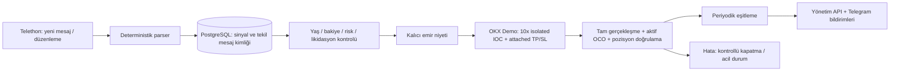

# Telegram → OKX Futures Demo Bot

Python 3.12+, Telethon, OKX REST API V5, FastAPI, PostgreSQL, SQLAlchemy ve Alembic
ile hazırlanmış, yalnızca **demo hesap** işlemleri yapan sabit sermaye slotlu servis.
Canlı işlem bu sürümde uygulanmaz: `OKX_DEMO=0` veya
`LIVE_TRADING_ENABLED=true` yapılandırma doğrulamasında reddedilir. İstemcide ayrıca
her istekte kontrol vardır ve `x-simulated-trading: 1` daima gönderilir.

Ayrı [salt okunur Live kontrol aracı](docs/live-read-only-connection.md) yalnız
Live GET bağlantısını test eder; emir yeteneği yoktur. [Live Docker hazırlık planı](docs/live-docker-deployment-plan.md)
ayrı belgelenmiştir. Trading servisi Demo'ya kilitli kalır.

Ayrı Windows laptop için [Live gözlemci kurulum rehberi](docs/live-deployment-guide.md)
ve `docker-compose.live.yml` hazırdır. Gözlemci sürekli paused çalışır; gerçek
emir executor'ı içermez ve Demo ortamını paylaşmaz. Komutlar, test sonuçları ve
kalan kabul adımları [Live teslimat raporundadır](docs/live-deployment-verification-report.md).

Telegram bağlantısı ve forum topic'leri gerçek serviste salt okunur doğrulandı.
Geliştirmede borsaya emir gönderilmedi; demo emir kabulü ve attached OCO davranışı
sahte borsa testleriyle doğrulanır.
Bu proje için production-ready iddiası yoktur. Demo `.env` dosyasına Live anahtar girmeyin.

Güncel kılavuzlar: [sermaye döngüsü](docs/capital-allocation.md),
[risk yönetimi](docs/risk-management.md), [Telegram komutları](docs/telegram-admin-commands.md),
[Docker dağıtımı](docs/docker-deployment.md), [live hazırlığı](docs/live-trading-readiness.md).

Son teslimat: [kabul raporu](docs/final-acceptance-report.md),
[kullanım, güvenli güncelleme ve geri dönüş](docs/user-guide.md),
[gelecekte Ubuntu VPS hazırlığı](docs/vps-deployment.md).

## Kurulum

Gereksinimler: Docker Engine + Compose veya yerel geliştirme için Python 3.12+ ve
[uv](https://docs.astral.sh/uv/). PostgreSQL için Compose kullanabilirsiniz.

```powershell
# Yalnızca yeni kurulumda; mevcut .env ve session korunur.
if (-not (Test-Path .env)) { Copy-Item .env.example .env }
```

`.env` dosyasını kendiniz doldurun. Bot gerçek anahtar oluşturmaz veya bu dosyaya
anahtar yazmaz. `ADMIN_API_TOKEN` için en az 32 karakterlik rastgele bir değer kullanın:

```powershell
python -c "import secrets; print(secrets.token_urlsafe(32))"
```

- OKX'te **Demo Trading** bölümünden Read + Trade yetkili demo API anahtarı oluşturun.
  Para çekme yetkisi gerekmiyor. Canlı anahtarlar demo ortamı için kullanılamaz;
  ilk özel hesap isteği başarısız olursa servis işlem başlatmaz.
- Başka bot veya manuel işlem bulunmayan ayrı bir demo hesap kullanın.
  Hesap **Futures mode (`acctLv=2`)** olmalı. Hesap modu otomatik değiştirilmez.
  `net_mode` ve `long_short_mode` desteklenir. Bu sürüm diğer hesap modlarını reddeder.
- `OKX_BASE_URL` hesap bölgesine uygun olmalı. Desteklenen resmi adresler:
  `https://www.okx.com`, `https://eea.okx.com`, `https://us.okx.com`.
- Telegram API ID/hash değerlerini [my.telegram.org](https://my.telegram.org) üzerinden alın.
  `TELEGRAM_CHANNEL_ID`, hesabınızın üyesi olduğu kanalın `-100...` biçimindeki sayısal ID'sidir.
- BotFather ile **ayrı bir yönetim botu** oluşturun; token'ını ve kendi sayısal kullanıcı
  ID'nizi girin. Bu botla özel sohbetten `/start` gönderin. Aynı token başka bir polling
  istemcisinde veya webhook ile kullanılmamalı.
- `POSTGRES_PASSWORD` için URL içinde kullanılabilir rastgele bir parola belirleyin.
  Yerel `DATABASE_URL` içindeki parola da aynı olmalı. Compose bağlantı adresini otomatik ayarlar.
- Sunucunun saatini NTP ile eşitleyin. Eski piyasa verisi, saat sapması ve süresi geçmiş
  mesajlar emir oluşturmaz.

Docker ile Telegram hesabına bir defalık giriş yapın:

```powershell
docker compose build
docker compose run --rm --no-deps trading-bot telegram-session
docker compose up -d
docker compose logs -f trading-bot
```

CLI telefon, doğrulama kodu ve varsa 2FA parolası ister. Oturum, container içindeki
`/app/data/telegram.session-string` dosyasına yazılır ve `telegram-session` volume'ünde
saklanır; sonraki açılışlarda SMS istenmez. `TELEGRAM_SESSION_STRING` isteğe bağlıdır;
doluysa dosyadan önce kullanılır. Oturum dosyasına erişim Telegram hesabına erişim sağlar.
Linux'ta dosya `0600` ile oluşturulur. Windows'ta ek olarak kullanıcıya özel NTFS
izinleri kullanın. `.env`, oturum ve veritabanı dosyaları Git/Docker build bağlamından dışlanır.

Container ayrı kullanıcıyla, salt okunur kök dosya sistemiyle çalışır. PostgreSQL ve
Telegram oturum volume'leri kalıcıdır. `docker compose down` verileri korur;
`down -v` volume'leri siler. Tek uygulama replikası ve tek Uvicorn worker kullanın.

## Yerel geliştirme ve test

```powershell
uv sync --python 3.12 --extra dev --frozen
uv run pytest -q
uv run ruff check .
uv run ruff format --check .
```

Bu testler gerçek API anahtarı gerektirmez; SQLite ve durum tutan OKX mock'ları kullanır.
İmzalı HTTP istekleri, LONG/SHORT, parser çelişkileri, duplikasyon, eski mesaj,
kısmi gerçekleşme, ACK kaybı, koruyucu emir hatası, likidasyon riski, yetkilendirme,
günlük zarar kilidi ve yeniden başlatma sonrası eşitleme kapsanır.

Gerçek PostgreSQL üzerinde ayrı bir kontrol:

```powershell
uv run python scripts/check_postgres.py
```

Script rastgele isimli, localhost'a bağlı geçici bir PostgreSQL container'ı oluşturur;
migration upgrade, `alembic check`, PostgreSQL entegrasyon testleri, downgrade ve tekrar upgrade
çalıştırır. Sonunda yalnızca kendi oluşturduğu container ve geçici verilerini temizler.
Mevcut container veya volume'lere dokunmaz. OKX/Telegram ağına bağlanmaz.

Yerel servisi çalıştırmak için `.env` ve oturumu hazırladıktan sonra:

```powershell
docker compose up -d postgres
uv run telegram-session
uv run alembic upgrade head
uv run uvicorn okx_bot.app:app --host 127.0.0.1 --port 8000 --workers 1 --no-access-log
```

`uv.lock` bağımlılıkları sabitler. Container başlangıç script'i migration'ı otomatik uygular.
Şema değişiklikleri `migrations/versions` altında sürümlenir; mevcut migration'ları
değiştirmek yerine yeni revision oluşturun.

## Sinyal kuralları

Telegram girişi hem izinli gruba hem doğrulanmış forum topic'ine bağlıdır.
Bu kurulumda `TELEGRAM_CHANNEL_ID=-1003769687656` ve `TELEGRAM_TOPIC_ID=23576`
kullanılır. Topic ayarı `0` ise veya mesajın topic'i çözülemiyorsa yeni sinyal
işlenmez. Diğer topic'ler parser'a ve bildirim kuyruğuna girmez.
[Topic doğrulaması ve filtreleme raporu](docs/telegram-topic-filter.md).

Desteklenen açık format:

```text
Coin: BTCUSDT
Fiyat: 100
Ortalama Aralık: %10
LONG
```

Bu fiyatlar yalnızca parser örneğidir. Gerçek piyasa fiyatı farklıysa risk kontrolü
sinyali reddeder. `CTUSDT`, yalnızca hesap için gerçekten mevcutsa `CT-USDT-SWAP`
sözleşmesine dönüştürülür. Sembol tahmini veya başka coine eşleme yapılmaz.

- Genel parser'da tek bir `...USDT` sembolü ve açık `LONG` veya `SHORT` zorunludur.
  İzinli MZTRADINGBOT kanalı için aşağıdaki özel kural kullanılabilir.
- Her sayısal alan ayrı satırda `Etiket: değer` biçimindedir. Türkçe/İngilizce
  etiketler desteklenir; alan kuralları `parser.py` içinde genişletilebilir.
- Fiyat için `Fiyat`, `Price`, `Entry`, `Giriş`; aralık için `Ortalama Aralık`,
  `Average Range`, `Range`; seviyeler için `TP`/`Take Profit`, `SL`/`Stop Loss` kullanın.
- Nokta veya virgül ondalık ayracı kabul edilir; binlik ayraç, bilimsel gösterim,
  giriş aralığı, TP1/TP2 ve çoklu hedefler desteklenmez, inceleme gerekir.
- `aralık = referans_fiyat × yüzde / 100`; her iki yönde TP ve SL mesafesi
  `aralık × Decimal('0.6')` olur. Hesaplamalar `Decimal` kullanır.
- Açık bir TP veya SL, o seviyenin hesaplanmış değerini değiştirir. Yön/fiyatla
  çelişen, belirsiz veya bozuk açık seviye tüm sinyali `needs_review` yapar.
  Aralık yoksa hem TP hem SL açıkça bulunmalıdır.
- Örneğin yalnızca `CTUSDT / 0.3604 / %17.33` içeren mesajda yön eksiktir;
  otomatik emir açılmaz, `needs_review` kaydedilir ve bildirilir.
- Telegram'ın **orijinal mesaj zamanı** yaş kontrolünde esas alınır. İsteğe bağlı
  `Time: 2026-10-20T12:00:00+03:00` alanı sinyalin zamanını yalnızca daha eskiye çekebilir.
  Mesaj düzenlemesi eski bir sinyalin süresini yenilemez.
- Henüz emir girişimi olmayan inceleme/reddedilmiş mesajlar düzenlemeyle tekrar
  değerlendirilebilir. Herhangi bir emir girişimi bulunan mesaj bir daha emir oluşturmaz.
- İlk başlangıçta kanalın mevcut son mesajı başlangıç sınırı olur; geçmişten emir
  açılmaz. Sonraki açılışlarda kalıcı cursor ve periyodik tarama ile kaçırılan mesajlar
  kontrol edilir. Yaş sınırını aşan sinyaller reddedilir. 500 mesajı aşan backlog
  otomatik işlemi durdurur ve inceleme gerektirir.

MZTRADINGBOT formatı için `MZTRADINGBOT_CHANNEL_ID`, mevcut izinli
`TELEGRAM_CHANNEL_ID` ile aynı sayısal kimliğe ayarlanır; `0` özel yorumu kapatır.
Yalnız doğrulanmış kaynak topic'te
`CTUSDT destekten dönüş için pozitif durumda, kontrol etmenizi öneririm.`
başlığı LONG, `BATUSDT dirençten dönüş için pozitif durumda, kontrol etmenizi öneririm.`
başlığı SHORT adayı sayılır. Çelişki, olumsuzlama ve belirsizlik otomasyona alınmaz.
Politika `mztradingbot_verified_topic_patterns_v2`, aday türü ve yorumlama kuralı
kalıcı kaydedilir. `Anlık Fiyat: 0.3604000000$` ve `Ortalama Aralık: %17.33`
alanları okunur; `CTUSDT`, `CT/USDT`, `CT-USDT` desteklenir. Yorumlama kuralı
`parsed.interpretation_rule` alanında saklanır. Bilinmeyen ifade yön tahminine yol açmaz.
Bu formattaki TP/SL katsayısı daima 0.6'dır; açık TP/SL ile değiştirilmez.
10x isolated, likidasyon, fiyat sapması, süre ve hesap riski kontrolleri aynen uygulanır.
Örneğin %17.33 aralık, %10.398 stop mesafesi üretir ve likidasyon kontrolünde reddedilebilir.

Telegram bildirimleri ve yönetim komutlarının metinleri merkezi
`telegram/formatting.py` modülünden Türkçe üretilir. Emir açılma bildirimi yalnız
gerçekleşme ve koruyucu emir doğrulamasından sonra, OKX verileriyle oluşturulur.
Kurulum, testler, güncelleme komutları ve örnekler:
[MZTRADINGBOT parser ve Türkçe bildirimler](docs/mztradingbot-turkish-notifications.md).

LLM kullanılmaz. `SignalParser` protokolü yeni parser'larla genişletilebilir.
İnceleme sinyallerini otomatik onaylayan bir komut bulunmaz; doğru formatlı yeni bir
mesaj veya henüz emir girişimi olmayan mesajın düzenlenmesi gerekir.

## Risk ve emir yaşam döngüsü



Varsayılanlar `.env.example` içindedir:

| Ayar | Varsayılan |
| --- | --- |
| `ALLOCATION_SLOTS` | 3 |
| `MAX_PORTFOLIO_RISK_PERCENT` | 40 |
| `MINIMUM_FREE_MARGIN` | 10 USDT |
| `MAX_OPEN_POSITIONS` | 3 |
| `MAX_SIGNAL_AGE_SECONDS` | 60 |
| `MAX_ENTRY_PRICE_DEVIATION_PERCENT` | 0.5 |
| `MAX_BID_ASK_SPREAD_PERCENT` | 0.5 |
| `MAX_DAILY_LOSS_PERCENT` | 3 |
| Kaldıraç / margin | Sabit 10x / isolated |
| TP / SL katsayısı | Sabit 0.6 / 0.6 |

Pozisyon büyüklüğü sermaye döngüsündeki sabit özkaynak/3 hedefi ve 10x kaldıraçtan
hesaplanır. Serbest bakiye azaldığında slot küçültülmez. Eski işlem başı risk yüzdesi
boyutlandırmada kullanılmaz; kanal stopu daraltılmaz. Miktar lot adımına aşağı yuvarlanır; minimum/maksimum
sözleşme miktarı ve kullanılabilir margin doğrulanır. Spot, ters sözleşmeler,
bilinmeyen çarpanlar ve normal işlemde olmayan sözleşmeler reddedilir.

Fiyat sapması ask/bid ve mark fiyatında kontrol edilir. Giriş emri fiyat sınırı olan
`ioc` emridir; tam gerçekleşmezse kalan miktar iptal edilir ve sahiplik/ayrılmış hesap
koşulları geçerse gerçekleşen miktara kontrollü çıkış uygulanır. Gerçekleşmiş fiyat tekrar denetlenir. Aralıktan türetilen TP/SL
gerçek ortalama fill üzerinden 0.6 katsayısıyla yeniden hesaplanır; açık mutlak
seviyeler korunup tekrar doğrulanır. Mevcut OCO eski koruma iptal edilmeden
değiştirilir ve GET ile teyit edilir. Referans, ilk/final seviyeler ve fill ayrı
kaydedilir. Stop ve TP tick adımına girişe doğru yuvarlanır; yuvarlama seviyeleri
bozarsa emir gönderilmez. Demo listesinde bulunmayan sözleşme için tekil Türkçe
manuel değerlendirme bildirimi üretilir; API hatası kayıp sözleşme sayılmaz.

Giriş öncesi tahmini likidasyon hesabı, OKX'in isolated USDT doğrusal sözleşme
formülünü kullanır. Sabit bir yüzde varsayılmaz: ilgili büyüklüğün `position-tiers`
verisindeki MMR ve hesabın sözleşmeye özel `feeGroup` taker oranı alınır.
Eski demo yanıtları için açık `takerU` alanı desteklenir. Eksik veri veya 10x'e
uygun olmayan kademe emir açılmasını engeller. Girişten sonra OKX'in gerçek
pozisyonda sağladığı `liqPx` ayrıca doğrulanır; uygun stop yoksa acil kilit ve belgelenmiş fail-safe uygulanır.

TP/SL mark fiyatıyla tetiklenen piyasa çıkışlarıdır. Attached TP/SL kimliği emir
gönderilmeden önce saklanır. Bot; aktif OCO durumunu, doğru sembol/yön/büyüklüğü,
trigger seviyelerini, margin ve reduce-only niteliğini doğrular. Koruma onayı
gelmezse ayrılmış hesap ve sahiplik koşullarıyla kontrollü çıkış denenir. Kapatma doğrulanamazsa `emergency` kaydı ve
kalıcı pause ile kullanıcıya acil müdahale bildirimi üretir. Yeni giriş açılmaz.

POST istekleri otomatik tekrar gönderilmez. ACK kaybında aynı giriş tekrar denenmez.
Kalıcı `prepared → submitting → open/closed` durumu, sabit client ID'leri ve
`(channel_id, message_id)` benzersizliği tekrar girişleri engeller. Yeniden başlangıçta
yarım kalan girişler borsadan sorgulanır ve mümkünse kapatılır. Bulunamayan bir
submission güvenli biçimde yok sayılmaz; inceleme gerekir.

Günlük risk günü **Europe/Istanbul**'dur; timestamp'ler UTC saklanır. Gün başlangıcında
ilk doğrulanan özkaynak kalıcı tutulur. Yalnızca bot fill'leri, işaretli fee ve
atfedilmiş funding net gerçekleşmiş PnL'ye girer; yatırma/çekme ve bot dışı işlemler
bot zararı sayılmaz. Limit gün sonuna kadar latch edilir. Günlük rapor 00:05'te
önceki gün için tekil outbox'a yazılır. Ayrıntılar [risk kılavuzunda](docs/risk-management.md).

## Yönetim ve sağlık

Yalnızca `TELEGRAM_ADMIN_ID` ile eşleşen kullanıcının özel sohbet komutları çalışır:

| Komut | Davranış |
| --- | --- |
| `/start` | Komutları gösterir |
| `/status` | Demo, pause ve eşitleme durumu |
| `/balance` | USDT özkaynak/kullanılabilir bakiye |
| `/positions` | Yalnızca kayıtlı bot pozisyonları |
| `/trades` | Son 20 bot emri |
| `/pause` | Yeni girişleri durdurur; koruma/eşitleme devam eder |
| `/resume` | Salt okunur güvenlik kontrolü yapar ve kısa süreli onay kodu verir; kilidi kaldırmaz |
| `/resume CONFIRM <kod>` | Aynı yönetici onayıyla kontrolleri tekrar yapar ve uygunsa kilidi kaldırır |
| `/close BTC-USDT-SWAP` | Yalnızca botun takip ettiği pozisyonu kapatır ve sonucu doğrular |
| `/stats` | Kayıtlı gerçekleşmeler, brüt gerçekleşmiş PnL ve USDT komisyonları |

Yeni sermaye, PnL ve iki aşamalı ayar komutları [Telegram kılavuzundadır](docs/telegram-admin-commands.md).
Mutating komutlar 60 saniye yaş sınırına tabidir. Her uygulama başlangıcında yeni
girişler `/resume` onayına kadar kapalıdır. OKX 401 yönetim servisinin başlangıcını
düşürmez; kalıcı kilit ve retry uygulanır. Telegram kayıp ACK durumunda kör tekrar
gönderilmez; belirsiz bildirim sayısı `/status` ile görünür.

FastAPI yalnızca localhost portuna açılır. Genel sağlık uçları:

```text
GET /health/live
GET /health/ready
```

Yönetim uçları `Authorization: Bearer <ADMIN_API_TOKEN>` ister:

```text
GET  /admin/status
GET  /admin/telegram
GET  /admin/balance
GET  /admin/positions
GET  /admin/trades
GET  /admin/stats
GET  /admin/allocation
GET  /admin/pnl
GET  /health/subsystems
POST /admin/pause
POST /admin/resume
POST /admin/positions/BTC-USDT-SWAP/close
```

`POST /admin/resume` ilk istekte `confirmation_required`, `confirmation` ve 120 saniyelik
son kullanma zamanı döndürür. Yetkili yönetici ikinci isteği
`{"confirmation":"ilk-istekte-verilen-kod"}` gövdesiyle gönderir. Onay kodu tek kullanımlıktır;
API ve Telegram arasında paylaşılamaz. Yeni hata, pause, restart, hesap/pozisyon değişikliği
veya süre aşımı yeniden onay gerektirir. Her iki adım da borsada yalnız GET kullanır;
emir açma, kapatma, iptal veya kaldıraç değiştirme yapmaz.

`/health/ready` PostgreSQL, Telegram listener ve son OKX eşitlemesini kontrol eder.
Yönetici pause durumu servis arızası sayılmaz. Zorunlu background task durursa
sağlık başarısız olur ve emirler engellenir. PostgreSQL singleton kilit bağlantısı
kaybolursa süreç sona erer; restart sonrası tekrar eşitleme yapılır.
Compose restart policy süreç çıkışında devreye girer; Docker'ın yalnızca `unhealthy`
işaretlediği çalışan container'ı kendi başına yeniden başlatmadığını dikkate alın.

`exchange_healthy=true` güvenlik kilidinin açıldığını göstermez. `/status` içindeki
`trading_enabled`, `requires_admin_approval` ve `reconciliation` alanları bu ayrımı
gösterir. Başarılı eşitleme geçmiş emergency'yi otomatik kaldırmaz. Migration `0002`
mevcut kayıtları ve kilitleri korur; hata aşaması/kodu ve toparlanma zamanını saklar.
Eski sürümün kaydetmediği hata ayrıntıları geçmişe dönük üretilmez.

Salt okunur tanı için:

```powershell
docker compose exec -T trading-bot python scripts/diagnose.py
```

Bu araç PostgreSQL'de salt okunur transaction ve OKX'te yalnız GET çağrıları kullanır.
Emir veya kilit değişikliği yapmaz. Hata incelemesi ve güncelleme adımları:
[Reconciliation inceleme raporu](docs/reconciliation-incident.md).

Structured JSON logları stdout'a gider. HTTP istek URL'leri, token'lar, oturumlar ve
ham exception içerikleri loglanmaz. Sinyal metni veritabanında tutulur; veritabanı
yedekleri ve erişim yetkileri işletmeci tarafından yönetilmelidir.

Telegram başlangıcında `Telegram listener starting`, `Telegram connected`,
`Channel subscribed` ve ilk başarılı taramada `Telegram listener ready` INFO logları
görünür. Yeni mesajlarda `Signal received` → `Signal parser started` →
`Signal parsed` / `Signal processed` kayıtları mesaj ID, coin, analiz sonucu ve
işlem durumunu gösterir. `needs_review` için `reason_code` eksik/çelişkili alanı
açıklar. Yinelenen veya başlangıç sınırından eski mesajlar DEBUG seviyesindedir;
periyodik tarama INFO loglarını tekrar doldurmaz. Ham mesajlar ve Telegram hesabının
telefonu/oturum bilgisi loglara yazılmaz. `LOG_LEVEL=INFO` kullanın.

Emir oluşturmadan Telegram kontrolü:

```powershell
docker compose exec -T trading-bot python scripts/telegram_diagnose.py
# Belirli mesajların forum başlıklarını ve topic metadata'sını karşılaştır:
docker compose exec -T trading-bot python scripts/telegram_diagnose.py --message-ids 23576 32877 32876
```

Araç çalışan dinleyicinin `/admin/telegram` durumunu ve ayrı, güncelleme almayan
salt okunur bir Telethon bağlantısını kontrol eder. Mesajın topic'ini ve metadata'sını
inceler; yalnız izinli topic'teki normal mesajı parser'a verir.
`engine.ingest()` çağırmaz, cursor/durum kaydetmez ve OKX'e bağlanmaz. Ayrıntılar:
[Telegram dinleyicisi ve loglar](docs/telegram-observability.md).

## Dosyalar ve operasyonel sınırlar

```text
src/okx_bot/
  config.py         Environment doğrulama ve demo kilidi
  domain.py         Sinyal/veri tipleri
  parser.py         Deterministik parser protokolü ve regex uygulaması
  models.py, db.py  Tablolar, session yönetimi, tek çalışan kilidi
  exchange/        İmzalı OKX REST istemcisi ve hesap adaptörü
  risk.py          Decimal boyutlandırma ve likidasyon kontrolü
  engine.py        Kalıcı emir akışı, TP/SL doğrulama ve recovery
  telegram/        Hesap listener'ı, oturum CLI ve ayrı yönetim botu
  app.py           FastAPI ve background görevlerinin yaşam döngüsü
migrations/        Alembic şeması
tests/             Mock HTTP, parser/risk/engine ve PostgreSQL testleri
scripts/           Container başlangıcı ve geçici PostgreSQL kontrolü
```

İstenen altı tabloya ek olarak `runtime_state` ve `daily_risk` kalıcı cursor,
pause/acil durum ve günlük zarar kilidini saklar. `executions` benzersiz işlem
kimliğiyle tekrar yüklemeye dayanıklıdır. Pozisyonlar başlangıçta ve varsayılan her
5 saniyede OKX ile karşılaştırılır. Telegram'ın otomatik yeniden bağlanmasına ek
olarak varsayılan her 10 saniyede mesaj/son düzenleme taraması yapılır.

Bilinen sınırlar:

- Gerçek demo uçlarında kabul testi, uzun süreli kesinti/yoğunluk testi ve operasyonel
  alarm/yedekleme kurulumu henüz yapılmadı. Mock testler gerçek borsa davranışının
  tüm ayrıntılarını kanıtlamaz. Attached OCO'nun hesap/bölge yanıtı beklenen biçime
  uymuyorsa bot pozisyonu açık bırakmak yerine kapatır veya acil duruma geçer.
- TP/SL veya kapatma emri piyasa likiditesi ve borsa erişimi gerektirir. Ağ kesintisinde
  botun borsada anında kapatma garantisi yoktur; acil durum bildirimi ve yeni giriş kilidi vardır.
- Tek proses mimarisi vardır; HA/multi replica veya başka botlarla ortak hesap desteklenmez.
  Takipsiz pozisyon ve bekleyen emirler otomatik işlemeyi durdurur, kendiliğinden kapatılmaz.
- Canlı işlem, çoklu hedefler, trailing stop, sinyalle mevcut pozisyonu değiştirme,
  pyramiding ve LLM parser bu sürümün kapsamı dışındadır.
- Gerçekleşme arşivi OKX'in 3 aylık API penceresiyle sınırlıdır. Çok uzun kesintiler
  sonrasında eksiksiz muhasebe için ayrıca dışa aktarım gerekir. Günlük risk için
  bugünün borsa hareketleri doğrudan sorgulanır; tamamlanamayan pagination reddedilir.
- Günlük limit brüt zarar yaklaşımı nedeniyle yalnızca net PnL kullanan bir sisteme
  göre daha erken durabilir. Para yatırma/çekme günlük performans raporu olarak modellenmez.
- Veritabanı temizlenerek veya eski yedek geri yüklenerek idempotency geçmişinin
  silinmesi desteklenen bir kurtarma yöntemi değildir. Oturum ve veritabanı volume'lerini yedekleyin.

Resmi başvuru kaynakları:
[OKX API V5](https://www.okx.com/docs-v5/en/),
[OKX isolated likidasyon formülleri](https://www.okx.com/en-us/help/forced-liquidation-faq),
[Telethon client ve yeniden bağlanma](https://docs.telethon.dev/en/stable/modules/client.html),
[Telethon güncellemeleri](https://docs.telethon.dev/en/stable/concepts/updates.html).

